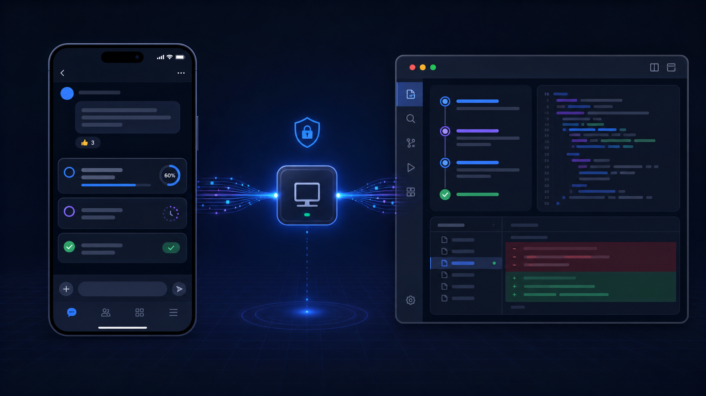
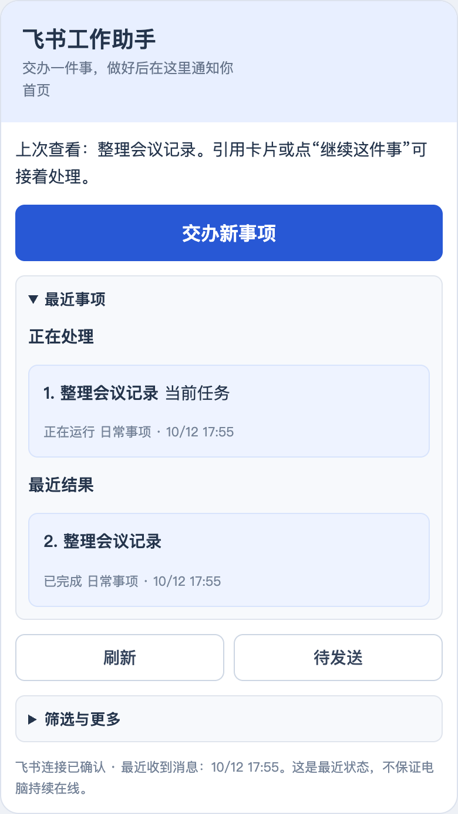
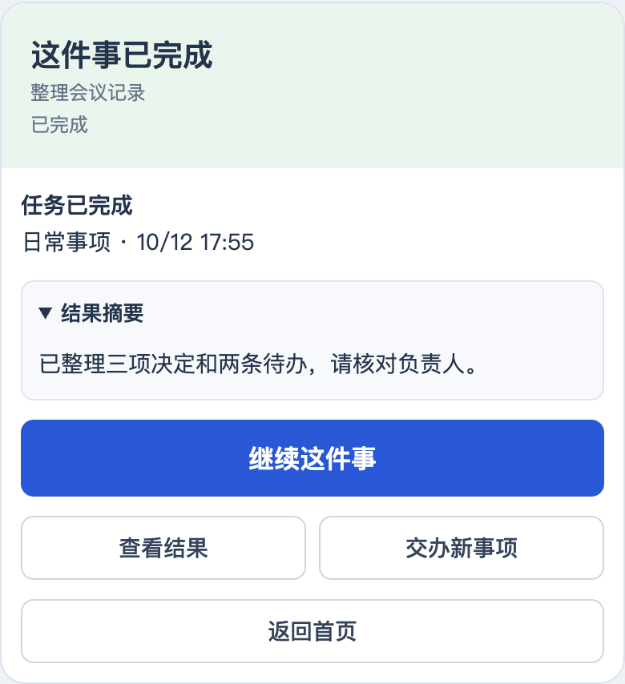
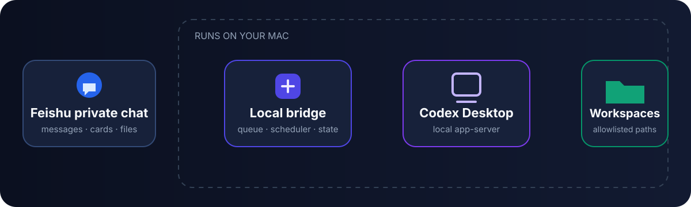

# Feishu Codex Bridge

<div align="center">

**Run Codex from Feishu. Keep execution on your Mac.**

A personal work assistant for drafting, summarizing, project work, and follow-ups.
Start a task in a Feishu or Lark private chat, check its progress, and continue
with the same Codex context. Execution stays on your Mac.

[Get started](docs/INSTALL.md) · [See how it works](docs/ARCHITECTURE.md) · [Usage guide](docs/USAGE.md) · [简体中文](README.zh-CN.md)

[](https://github.com/chengzeli7/feishu-codex-bridge/actions/workflows/ci.yml)
[](LICENSE)
[](CHANGELOG.md)

</div>



> **Public beta:** `v0.1.6` uses local app-server capabilities currently bundled
> with Codex Desktop. A future Codex update may require a compatibility update.

## What problem does it solve?

Codex Desktop works on your Mac, but you are not always sitting in front of it.
Feishu Codex Bridge turns a private bot chat into a lightweight task console:

1. Tap **交办新事项** (start new work), select an allowed workspace, and describe the task.
2. Open the task to see its summary, plan, tools, changes, and any required action.
3. Receive the result card, then tap **继续这件事** (continue this task) to follow up.
4. Use **返回首页** (home) to switch tasks, inspect pending messages, or create a local schedule.

A workspace can be a dedicated folder for everyday work or a project repository.
The bridge does not require every request to be a coding task.

## What is new in v0.1.6?

- **Clearer cards:** one large primary button per page, at most two secondary
  buttons per row, and separate navigation. Completed tasks lead directly to continuation.
- **Explicit message targets:** ordinary messages after viewing a task ask whether
  to continue it or start another. Quoted replies and explicit commands stay direct.
- **Recovery you can inspect:** pending messages stay beside their task. Definite
  dispatch failures back off and pause after five attempts; uncertain submissions
  remain held for verification instead of exposing a blind retry.
- **Accurate connection hints:** listener startup alone is not reported as a
  confirmed Feishu connection. Fresh event-file delivery also updates the status.
- **Honest completion status:** provider errors in terminal events remain failures;
  rate limits are reported instead of showing an empty successful result.
- **Desktop compatibility:** supports both bundled executable layouts and routes
  continuation through the existing Desktop owner without taking its writer.
- **Safer installation and upgrades:** preflight checks precede daemon startup;
  upgrades retain the paired bot profile and data, then verify the installed service.

See the [changelog](CHANGELOG.md) and [latest release](https://github.com/chengzeli7/feishu-codex-bridge/releases/latest).

## Current card preview

| Home: choose the next action | Result: continue the same task |
|---|---|
|  |  |

These are HTML approximations rendered from the v0.1.6 Card 2.0 sample data,
not native Feishu screenshots. Feishu controls the final rendering. The
[earlier concept animation](docs/images/product-demo.gif) illustrates the basic
workflow; its labels and layout predate this release.

## Everyday workflows

| You want to… | Use this path |
|---|---|
| Start a new request | **交办新事项** → choose a workspace → submit. Plain text also creates work when no task is focused. |
| Continue a result | **继续这件事**, quote the intended card, or send `继续1 Add a regression test`. Opening a card alone is not a quoted reply. |
| Add an image or file | Send it in the bot chat composer, preferably as a quoted reply to the target card. The continuation form accepts text only. |
| Check progress or a failure | Open the task summary and detailed progress. Additional permissions or human input are handled in Codex Desktop. |
| Inspect waiting work | Open **待发送**. Check the exact task before retrying a definite failure; do not resend an uncertain submission. |
| Schedule work | Home → **筛选与更多** → **定时事项** → **新增定时事项**. One-time, daily, and weekly schedules run on the Mac. |

Short voice input is optional and needs Feishu ASR permission plus `ffmpeg`.
Replies are persisted before delivery; uncertain task submissions are reconciled
against exact IDs in Codex history. See [usage](docs/USAGE.md) and
[recovery details](docs/ARCHITECTURE.md#local-state-and-recovery).

## Is it for you?

| A good fit when you… | Choose something else when you… |
|---|---|
| use Codex Desktop regularly on a personal Mac | need Linux, Windows, or an always-on cloud runner |
| want to check or continue tasks from your phone | need full screen, mouse, or keyboard control |
| want code and credentials to stay local | need a shared multi-user bot |
| are comfortable allowlisting specific projects | need unrestricted filesystem access |

## How it works



Feishu transports messages and renders cards. The bridge, queue, scheduler, Codex
runtime, and project files all run locally on your Mac. Read the
[architecture overview](docs/ARCHITECTURE.md) for task ownership and recovery details.

## Quick start

### One prompt to Codex — installation and upgrades

Open a new Codex task on the target Mac and send this entire prompt:

```text
Install and configure Feishu Codex Bridge on this Mac by following:
https://github.com/chengzeli7/feishu-codex-bridge/blob/main/docs/CODEX_INSTALL.md
Read the guide and then execute it autonomously. Pause only when the guide says
that I must complete a browser, Feishu, macOS, or pairing action.
```

Codex downloads the project, uses a persistent Node.js runtime, runs guided
setup, installs the per-user background service, and verifies it. You only step
in for browser confirmation, Feishu app publication, macOS permission prompts,
and the one-time private-chat pairing message.

Use the same prompt for an upgrade. Codex resolves the latest published release,
keeps your paired bot and local state, and verifies the new installation. You do
not need to copy terminal commands or install Homebrew for this path.

If first-time shared-daemon setup requires a Desktop restart, Codex will say so;
it must not close your active chat on your behalf. After verification, send:

```text
健康
任务
Summarize the following notes into three action items: …
```

Prefer installing it yourself? See the complete [installation guide](docs/INSTALL.md)
for source installation and the separately versioned Homebrew channel. Use the
one-prompt path when you need the latest published release.

### What to expect

| Item | Expectation |
|---|---|
| Typical setup time | About 5–15 minutes, depending on Feishu app publication |
| Automated | Download, dependency setup, local configuration, LaunchAgent, diagnostics |
| Requires you | Browser confirmation, Feishu app publication, macOS prompts, one pairing message |
| Installed data | `~/Library/Application Support/CodexFeishuBridge` |
| Logs | `~/Library/Logs/CodexFeishuBridge` |
| Removal | Ask Codex to stop/uninstall the bridge; configuration and data are preserved. Homebrew users can run `feishu-codex-bridge uninstall`. |

The installer preserves existing bridge state, Feishu profiles, and project
files. It enables the per-user shared Codex daemon environment and records the
selected Node.js runtime in the LaunchAgent; it does not change global Git configuration.

An installation is complete only after **doctor passes, the daemon and Bridge
are running, and a real Feishu request returns a card**. A running process or
listener-ready log alone does not prove end-to-end delivery. See the
[installation acceptance checklist](docs/CODEX_INSTALL.md#6-verify-and-report).

## Safety by design

- **Single owner:** private chat by default; optional allowlisted groups accept only the paired owner's messages that mention this bot.
- **Workspace allowlist:** new tasks can start only in configured project paths.
- **No remote approval bypass:** Feishu-started turns use `approvalPolicy: never`.
- **Local credentials:** Feishu secrets and Codex credentials never belong in the repository.
- **Filtered progress:** raw reasoning, full tool arguments, terminal output, and common secrets are excluded or redacted.
- **No remote desktop:** the bridge cannot view the screen or control the mouse and keyboard.

Treat access to the paired Feishu account as access to the configured workspaces.
Review [SECURITY.md](SECURITY.md) before deployment.

## Current scope

| Supported | Not supported yet |
|---|---|
| macOS | Linux and Windows |
| One allowlisted Feishu user | Multiple users |
| Private bot chat and opt-in owner-only groups | Commands from other group members |
| Codex runtime bundled with ChatGPT Desktop | Cloud-hosted Codex routing |
| Allowlisted local workspaces | Arbitrary directory access |

The Mac must be awake and online. A sleeping or powered-off Mac cannot process
messages; this is a local bridge, not a cloud relay. Only events already received
are persisted. Messages never delivered during a disconnect are not guaranteed
to be recovered. A connection hint reflects observed activity, not continuous availability.

The current Feishu cards and deterministic commands are Chinese-first. Natural
language task prompts may be written in any language supported by Codex; full
card and command localization is planned for a later release.

## How is it different?

| Capability | Feishu Codex Bridge | Remote desktop | Generic chat bot |
|---|---|---|---|
| Structured Codex task progress | Built in | Visible only through the screen | Requires custom integration |
| Continue the same Codex task | Continue button, quoted card reply, or command | Manual Desktop interaction | Requires custom task binding |
| Code and credentials stay on the Mac | Yes | Yes | Depends on the bot architecture |
| Mobile interaction | Native Feishu cards | Streamed desktop UI | Chat only |
| Screen, mouse, and keyboard control | No | Yes | No |

## Compatibility

| Component | Current support |
|---|---|
| Operating system | macOS |
| Codex | Runtime bundled with ChatGPT Desktop |
| Node.js | 20, 22, and 24 are covered by CI |
| Feishu/Lark | Custom app, bot capability, private chat; optional allowlisted groups |
| `lark-cli` | Bundled dependency, currently `1.0.89` |

## Frequently asked questions

<table>
  <tr>
    <td width="50%" valign="top">
      <strong>Is this a cloud service?</strong><br><br>
      No. Feishu transports messages and cards; execution, queues, files, and credentials stay on your Mac.
    </td>
    <td width="50%" valign="top">
      <strong>Can it read every file?</strong><br><br>
      No. New tasks are restricted to allowlisted projects and remain subject to Codex and macOS permissions.
    </td>
  </tr>
  <tr>
    <td width="50%" valign="top">
      <strong>Why no reply after the Mac sleeps?</strong><br><br>
      There is no cloud relay. A sleeping or powered-off Mac cannot consume or execute messages.
    </td>
    <td width="50%" valign="top">
      <strong>Can one bot control several Macs?</strong><br><br>
      Use a separate Feishu app per Mac to avoid event-stream races, missed messages, or duplicate work.
    </td>
  </tr>
  <tr>
    <td width="50%" valign="top">
      <strong>Does group chat work?</strong><br><br>
      Optional, not shared access. Explicitly allowlist a group and configure the bot ID; only the paired owner can send commands by mentioning this bot. Replies stay in the group stream. See <a href="docs/CONFIGURATION.md#optional-owner-only-groups">configuration</a>.
    </td>
    <td width="50%" valign="top">
      <strong>What if Codex needs approval?</strong><br><br>
      Remote turns use <code>approvalPolicy: never</code>. Handle extra permissions or human input in Codex Desktop.
    </td>
  </tr>
</table>

More answers and diagnostic steps are in [Troubleshooting](docs/TROUBLESHOOTING.md).

## Documentation

| Guide | What it covers |
|---|---|
| [Installation](docs/INSTALL.md) | Codex-managed, Homebrew, and source installation |
| [Usage](docs/USAGE.md) | Natural language, exact commands, attachments, schedules, and queues |
| [Configuration](docs/CONFIGURATION.md) | Allowlist, workspaces, bot profile, paths, and limits |
| [Architecture](docs/ARCHITECTURE.md) | Components, data flow, task ownership, and local-first design |
| [Troubleshooting](docs/TROUBLESHOOTING.md) | No replies, writer conflicts, stale cards, voice, and diagnostics |
| [Multiple Macs](docs/MULTI_MAC.en.md) | Why each Mac should use a separate Feishu app |
| [Codex-managed installer](docs/CODEX_INSTALL.md) | The autonomous installation contract used by Codex |

## Release and verification

Every release keeps package metadata, bilingual docs, the Git tag, and the
GitHub Release aligned so the one-prompt installer retrieves the intended build.
CI runs the test suite and Card 2.0 validation on Node.js 20, 22, and 24. Installer
regression tests run real setup and service scripts in an isolated filesystem,
with macOS services and Feishu authentication/pairing simulated; live acceptance
is recorded separately in the release notes. See the [release checklist](docs/RELEASING.md).

## Contributing

See [CONTRIBUTING.md](CONTRIBUTING.md). Do not open a public issue for a
vulnerability; follow [SECURITY.md](SECURITY.md) instead.

## License

[Apache License 2.0](LICENSE)

## Disclaimer

This is an unofficial community project and is not affiliated with or endorsed
by OpenAI, Feishu, Lark, or ByteDance. Codex, ChatGPT, Feishu, and Lark are
trademarks of their respective owners.
