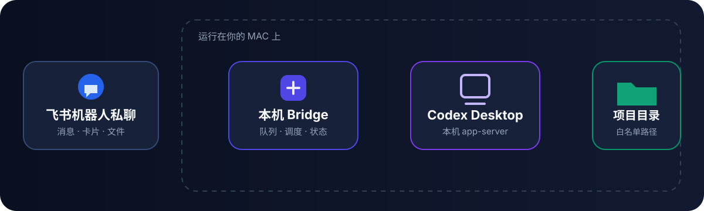

# Feishu Codex Bridge

<div align="center">

**在飞书里使用 Codex，所有执行仍留在你的 Mac。**

一个个人工作助手：整理文字、总结材料、跟进项目，也可以处理代码任务。
在飞书私聊中交办、查看结果、接着处理，沿用同一个 Codex 上下文。

[快速开始](docs/INSTALL.zh-CN.md) · [工作原理](docs/ARCHITECTURE.zh-CN.md) · [使用指南](docs/USAGE.zh-CN.md) · [English](README.md)

[](https://github.com/chengzeli7/feishu-codex-bridge/actions/workflows/ci.yml)
[](LICENSE)
[](CHANGELOG.md)

</div>


> **公开 Beta：** 当前版本为 `v0.1.6`。项目依赖 Codex Desktop 现有的本地
> app-server 能力，后续 Codex 更新可能需要同步进行兼容性适配。

## 它解决什么问题？

Codex Desktop 在你的 Mac 上工作，但你不一定一直坐在电脑前。
Feishu Codex Bridge 把机器人私聊变成一个轻量的任务控制台：

1. 点击 **交办新事项**，选择允许访问的范围，说清楚要做什么。
2. 打开事项，查看摘要、计划、工具、文件改动和需要处理的问题。
3. 收到结果后，点击 **继续这件事**，沿用原来的上下文补充要求。
4. 点击 **返回首页** 切换事项、查看待发送消息，或设置本机定时任务。

处理范围可以是专门存放日常材料的目录，也可以是项目仓库，不要求每件事都与代码有关。

## v0.1.6 更新了什么？

- **页面更清楚：** 每页一个整行主按钮，次要操作每行最多两个，返回入口单独排列；完成后直接继续对应事项。
- **补充不会发错地方：** 查看过事项后直接发普通消息，会先询问继续哪件事或另开一件事；引用回复和明确继续指令仍直接处理。
- **等待与恢复可核对：** 消息按事项分组，明确发送失败时退避重试、五次后暂停；提交结果不确定时保留待核对，不提供盲目重试。
- **连接提示更准确：** 监听器启动不等于连接已确认，新收到的文件投递事件也能更新连接状态。
- **结束不冒充成功：** 终止事件包含服务端错误时显示失败；遇到限流会明确提示，不再展示空白的成功结果。
- **兼容新版 Desktop：** 支持新旧内置运行时路径，通过已有 Desktop 持有者继续任务，避免争抢写入权。
- **安装与升级更可靠：** 先做安装前检查，再启动 daemon；升级保留配对 Profile 和数据，最后验证安装后的服务。

详见[更新日志](CHANGELOG.md)和[最新 Release](https://github.com/chengzeli7/feishu-codex-bridge/releases/latest)。

## 当前卡片预览

| 首页：选择下一步 | 结果：继续同一件事 |
|---|---|
|  |  |

上图由 v0.1.6 的 Card 2.0 示例数据生成，是 HTML 布局近似预览，实际效果以飞书渲染为准，
不是飞书实机截图。[早期概念动画](docs/images/product-demo.gif)仍可查看基本流程，其中的文案与布局早于当前版本。

## 日常怎么用？

| 想做什么 | 操作方式 |
|---|---|
| 交办新事项 | **交办新事项** → 选择范围 → 提交；没有当前事项时，也可以直接发普通消息。 |
| 接着处理结果 | 点击 **继续这件事**、引用回复对应卡片，或发送 `继续1 再补一个回归测试`。只打开卡片不等于引用回复。 |
| 补充图片或文件 | 从机器人聊天输入框发送，推荐引用回复对应事项卡；继续表单只填写文字。 |
| 查看进展或失败原因 | 打开事项摘要和详细进展；需要额外权限或人工输入时回 Codex Desktop 处理。 |
| 查看等待中的消息 | 打开 **待发送**，核对目标和失败原因；明确失败才重试，待核对提交不要重复发送。 |
| 设置定时事项 | 首页 → **筛选与更多** → **定时事项** → **新增定时事项**，支持一次性、每日和每周执行。 |

短语音是可选能力，需要飞书 ASR 权限和 `ffmpeg`。回复先持久化再发送，
提交结果不确定时通过精确标识核对 Codex 历史。详见[使用指南](docs/USAGE.zh-CN.md)
和[恢复机制](docs/ARCHITECTURE.zh-CN.md#本机状态与恢复)。

## 它适合你吗？

| 适合这些情况 | 建议选择其他方案 |
|---|---|
| 经常在个人 Mac 上使用 Codex Desktop | 需要 Linux、Windows 或持续在线的云端执行器 |
| 希望从手机查看或继续任务 | 需要完整控制屏幕、鼠标或键盘 |
| 希望代码和凭据留在本机 | 需要多人共享的机器人 |
| 可以明确配置允许访问的项目 | 需要不受限制地访问任意目录 |

## 工作原理



飞书只负责传输消息和展示卡片。Bridge、消息队列、调度器、Codex 运行时和
项目文件都运行在你的 Mac 上。任务所有权与断线恢复机制见
[架构说明](docs/ARCHITECTURE.zh-CN.md)。

## 快速开始

### 一句话交给 Codex：安装与升级

在目标 Mac 上打开 Codex，新建任务，把下面整段发送给 Codex：

```text
请按照下面的 Codex 托管安装指南，在这台 Mac 上安装并配置 Feishu Codex Bridge：
https://github.com/chengzeli7/feishu-codex-bridge/blob/main/docs/CODEX_INSTALL.md
阅读指南后直接自主执行。只有指南明确要求我完成浏览器、飞书、macOS 授权或配对操作时
才暂停。
```

Codex 会自动下载项目、选择持久化 Node.js 运行时、执行引导配置、安装当前用户的
后台服务并完成验证。你只需要处理浏览器确认、发布飞书应用、macOS 权限提示，以及
发送一次机器人私聊配对消息。

升级也发送同一段提示词。Codex 会解析最新已发布 Release，保留原机器人配对和本机状态，
完成升级验证；这个入口不要求你复制终端命令或安装 Homebrew。

如果首次共享 daemon 配置需要重启 Desktop，Codex 会明确提示，不会主动关闭你当前的会话。
验证完成后，在飞书依次发送：

```text
健康
任务
把下面的记录整理成三条待办：……
```

希望自己安装？源码流程和独立维护的 Homebrew 渠道见[安装指南](docs/INSTALL.zh-CN.md)。
Homebrew 配方可能晚于 GitHub Release；需要最新版本时优先使用上述一句话安装。

### 安装前可以预期什么

| 项目 | 说明 |
|---|---|
| 常见耗时 | 约 5～15 分钟，具体取决于飞书应用发布过程 |
| 自动完成 | 下载、依赖安装、本机配置、LaunchAgent 和诊断 |
| 需要你处理 | 浏览器确认、发布飞书应用、macOS 提示和一次配对消息 |
| 安装数据 | `~/Library/Application Support/CodexFeishuBridge` |
| 日志 | `~/Library/Logs/CodexFeishuBridge` |
| 卸载 | 让 Codex 停止或卸载 Bridge，保留配置和数据；Homebrew 用户也可执行 `feishu-codex-bridge uninstall`。 |

安装器保留已有 Bridge 状态、飞书 Profile 和项目文件；会启用当前用户的 Codex 共享 daemon
环境，并将选定的 Node.js 路径写入 LaunchAgent，不修改全局 Git 配置。

安装完成的标准是：**doctor 通过、daemon 和 Bridge 正在运行、真实飞书请求收到卡片回复**。
只有进程存在或监听器 ready 还不算全流程成功。详见[安装验收步骤](docs/CODEX_INSTALL.md#6-verify-and-report)。

## 安全边界

- **单用户控制：** 默认使用配对私聊；可选群聊白名单，但只接受配对用户 @ 当前机器人的消息。
- **项目白名单：** 新任务只能进入明确配置的项目目录。
- **不绕过审批：** 飞书创建的回合使用 `approvalPolicy: never`。
- **凭据保留本地：** 飞书和 Codex 凭据不会写入仓库。
- **进展信息过滤：** 不展示原始 reasoning、完整工具参数和完整终端输出，常见密钥会脱敏。
- **不是远程桌面：** 不能查看电脑屏幕，也不能控制鼠标和键盘。

飞书账号一旦可以访问机器人，就相当于可以访问白名单中的项目。部署前请阅读
[SECURITY.md](SECURITY.md)。

## 当前支持范围

| 已支持 | 暂未支持 |
|---|---|
| macOS | Linux 和 Windows |
| 单个白名单飞书用户 | 多用户 |
| 机器人私聊、可选的单用户控制群聊 | 其他群成员发送控制指令 |
| ChatGPT Desktop 内置 Codex 运行时 | 云端 Codex 路由 |
| 明确配置的本地项目 | 任意目录访问 |

Mac 必须保持唤醒并联网。睡眠或关机后无法处理消息，因为它是本机 Bridge，
不是云端中转服务。仅已收到的事件会持久化；断线期间未送达的消息不保证补回。
“连接已确认”反映最近观察到的活动，不是持续在线保证。

当前飞书卡片和精确命令以中文为主；自然语言任务可以使用 Codex 支持的其他语言。
完整的卡片和命令多语言支持将在后续版本提供。

## 和其他方案有什么区别？

| 能力 | Feishu Codex Bridge | 远程桌面 | 普通聊天机器人 |
|---|---|---|---|
| 结构化 Codex 任务进展 | 内置 | 只能通过屏幕查看 | 需要自行集成 |
| 继续同一个 Codex 任务 | 回复卡片或精确命令 | 手动操作 Desktop | 需要自行绑定任务 |
| 代码和凭据保留在 Mac | 是 | 是 | 取决于机器人架构 |
| 手机交互体验 | 原生飞书卡片 | 桌面画面串流 | 只有聊天 |
| 控制屏幕、鼠标和键盘 | 否 | 是 | 否 |

## 兼容性

| 组件 | 当前支持 |
|---|---|
| 操作系统 | macOS |
| Codex | ChatGPT Desktop 内置运行时 |
| Node.js | CI 覆盖 20、22 和 24 |
| 飞书/Lark | 企业自建应用、机器人能力、私聊；可选白名单群聊 |
| `lark-cli` | 项目内置依赖，当前为 `1.0.89` |

## 常见问题

<table>
  <tr>
    <td width="50%" valign="top">
      <strong>这是云服务吗？</strong><br><br>
      不是。飞书只传输消息和卡片，执行、队列、文件与凭据都留在你的 Mac。
    </td>
    <td width="50%" valign="top">
      <strong>可以读取所有文件吗？</strong><br><br>
      不可以。新任务仅限项目白名单，并继续受 Codex 与 macOS 权限限制。
    </td>
  </tr>
  <tr>
    <td width="50%" valign="top">
      <strong>为什么 Mac 睡眠后不回复？</strong><br><br>
      项目没有云端中转。Mac 睡眠或关机后，本机 Bridge 无法接收和执行消息。
    </td>
    <td width="50%" valign="top">
      <strong>一个机器人能控制多台 Mac 吗？</strong><br><br>
      建议每台 Mac 使用独立飞书应用，避免长连接抢占、漏处理或重复执行。
    </td>
  </tr>
  <tr>
    <td width="50%" valign="top">
      <strong>支持群聊吗？</strong><br><br>
      可以按需开启，但不是多人共享。明确配置群白名单和机器人 ID 后，只接受配对用户 @ 当前机器人的指令，回复直接进入群消息流。见<a href="docs/CONFIGURATION.zh-CN.md#可选的单用户控制群聊">配置说明</a>。
    </td>
    <td width="50%" valign="top">
      <strong>Codex 需要审批怎么办？</strong><br><br>
      远程回合使用 <code>approvalPolicy: never</code>，额外权限或人工输入需回到 Codex Desktop。
    </td>
  </tr>
</table>

更多答案和诊断步骤见[故障排查](docs/TROUBLESHOOTING.zh-CN.md)。

## 文档

| 指南 | 内容 |
|---|---|
| [安装](docs/INSTALL.zh-CN.md) | Codex 托管、Homebrew 和源码安装 |
| [使用](docs/USAGE.zh-CN.md) | 自然语言、精确命令、附件、定时任务和队列 |
| [配置](docs/CONFIGURATION.zh-CN.md) | 白名单、项目、机器人 Profile、路径和限制 |
| [架构](docs/ARCHITECTURE.zh-CN.md) | 组件、数据流、任务所有权和本地优先设计 |
| [故障排查](docs/TROUBLESHOOTING.zh-CN.md) | 不回复、窗口冲突、卡片不更新、语音和诊断 |
| [多台 Mac](docs/MULTI_MAC.md) | 为什么每台 Mac 应使用独立飞书应用 |
| [Codex 托管安装指南](docs/CODEX_INSTALL.md) | Codex 自动安装时遵循的执行约定 |

## 发布与验证

每次发布都要对齐包版本、中英文文档、Git 标签和 GitHub Release，保证一句话安装拿到目标版本。
CI 在 Node.js 20、22、24 上运行测试和卡片校验。安装回归在隔离目录中执行真实 setup/service
脚本，模拟 macOS 服务及飞书授权、配对边界；真实环境验收另记在 Release 说明中。
维护流程见[发布检查表](docs/RELEASING.md)。

## 贡献

参见 [CONTRIBUTING.md](CONTRIBUTING.md)。安全问题请不要创建公开 Issue，
应按照 [SECURITY.md](SECURITY.md) 中的方式提交。

## License

[Apache License 2.0](LICENSE)

## Disclaimer

这是社区维护的非官方项目，与 OpenAI、飞书、Lark 或字节跳动不存在隶属或官方合作关系。
Codex、ChatGPT、Feishu 和 Lark 等名称及商标归各自权利人所有。
